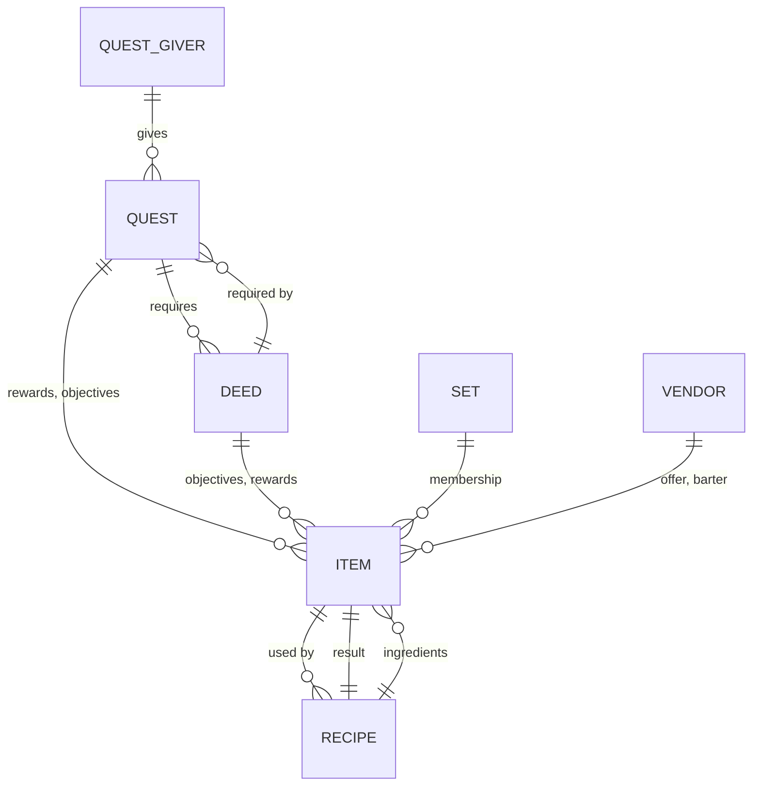
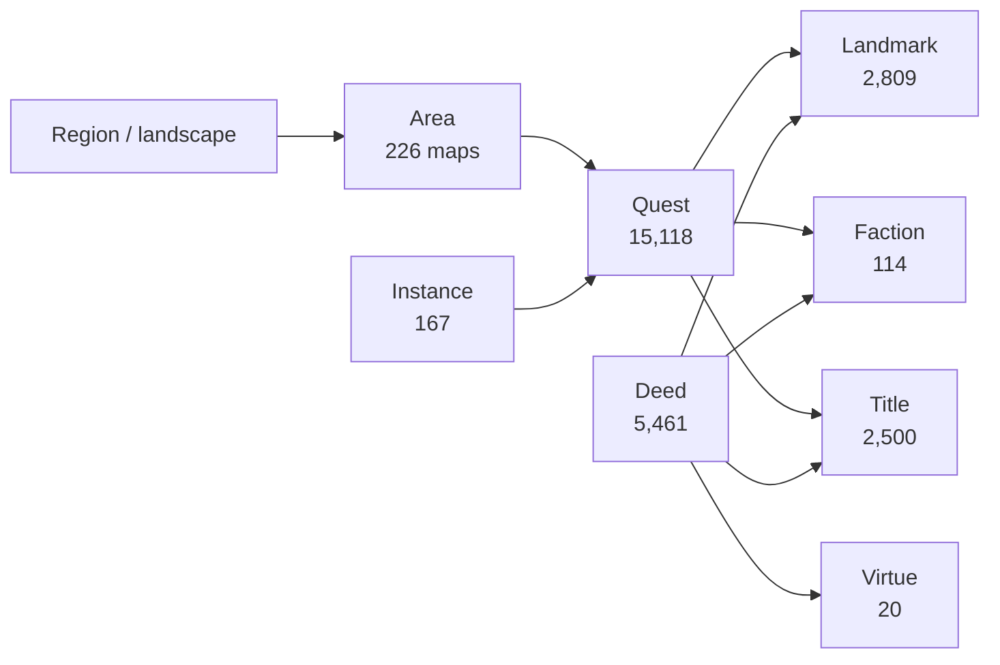

# Entity and relation model

What the catalogue contains, how the pieces relate, and how much of each there
is. Measured on 22.11.2026 from the built German catalogue; every number comes
from `lotro_datenraum_zaehlung.py` and is stored in
[`lotro-datenraum-zaehlung.json`](lotro-datenraum-zaehlung.json). The German,
English and French catalogues carry the same objects; only the display texts
differ.

This document describes **structure and quantity**, not game texts. It contains
no quest text, no item data and no map image; it names fields and counts them.

## Entities

| Entity | Key | Count | English | German | French |
|---|---|---|---|---|---|
| Quest | `q` | 15,118 | quest | Aufgabe | quête |
| Deed | `d` | 5,461 | deed | Tat | prouesse |
| Item | `i` | 52,802 | item | Gegenstand | objet |
| Recipe | `recipe` | 7,924 | recipe | Rezept | recette |
| Set | `set` | 2,223 | set | Set | ensemble |
| Title | `title` | 2,500 | title | Titel | titre |
| Virtue | `virtue` | 20 | virtue | Tugend | vertu |
| Faction | `f` | 114 | faction | Fraktion | faction |
| Quest giver | `giver` | 5,067 | quest giver | Auftraggeber | donneur de quête |
| Vendor | `vendor` | 1,562 | vendor | Händler | marchand |
| Landmark | `l` | 2,809 | landmark | Landmarke | site |
| Instance | — | 167 | instance | Instanz | instance |
| Landscape / area | `region`, `area` | 226 maps | landscape, area | Landschaft, Gebiet | paysage, région |
| Resource occurrence | `v` | 164 maps | resource occurrence | Vorkommen | gisement |

Two counts need their limit stated: the 226 maps are the parchment maps the
catalogue can address, not every interior map in the client. The 20 virtues are
the ones the client exposes as reward-bearing virtues; that is not a claim about
the full virtue system.

## Relations





The arrows show the observed direction of the reference, not a database
constraint. Multiple occurrences are measured, not guaranteed: a quest can have
several givers, an item can belong to several sets, and a recipe can have
several versions. The two diagrams cover the relations that carry numbers;
titles, virtues, factions, landmarks and instances appear here only with their
counts and in the tables below.

## Quantities per relation

| Relation | Source field | Occurrences | Resolved | Evidence |
|---|---|---|---|---|
| Quest → quest giver | `bestower/@npcId` → `NPC/@id` | 13,380 | 12,389 | main audit, 991 open in the NPC export |
| Quest → objective item | `object/@id` → `item/@key` | 19,726 | 19,726 | main audit |
| Deed → objective item | `object/@id` → `item/@key` | 4,174 | 4,174 | main audit |
| Quest → prerequisite | `prerequisite/@id` → quest and deed IDs | 13,067 | 13,067 | main audit, shared ID space |
| Deed → prerequisite | `prerequisite/@id` → quest and deed IDs | 62 | 62 | main audit |
| Set → item | `set/item/@id` → `item/@key` | 11,159 | 11,159 | main audit |
| Recipe → item | `@itemId` → `item/@key` | 80,919 | 80,919 | main audit |
| Vendor → item | sell entry → `item/@key` | 43,006 | — | catalogue count |
| Quest → title | `title/@id` → `title/@id` | 231 | 231 | main audit |
| Deed → title | `title/@id` → `title/@id` | 2,377 | 2,377 | main audit |
| Deed → faction | `factionLevel/@factionId` | 680 | 680 | main audit |
| Quest → landmark | `landmarkDetection/@landmarkId` | 747 | 747 | main audit |
| Deed → landmark | `landmarkDetection/@landmarkId` | 1,696 | 1,696 | main audit |
| Quest → reward item | compact `rw` entries | 13,035 links | — | catalogue count, 1,395 distinct items |
| Deed → reward | compact `rw` present | 4,445 deeds | — | catalogue count |

"Resolved" means the target ID exists in the target set that was checked. It
does not mean the character can reach it, unlock it or see it in the game.

## What the checks cover

| Check | Rules | References | Unresolved |
|---|---|---|---|
| Main reference check | 25 | 210,908 | 991 |
| Deep typed reference check | 61 | 416,636 | 1,270 |

The 991 open quest giver references (613 distinct IDs) are not invalid IDs: 519
of them have a decoded record in the NPC- or placement exports and all 613 occur
in the DAT inventory. Class 796 is `IItem` in the decoder, class 1723 is
`MonsterTemplate`, class 1724 is `NPCTemplate`. A quest giver is a role across
several source classes, not an NPC identity.

## What this model does not claim

- **No complete semantics.** Field presence is recorded; the meaning of every
  DAT class is not decoded. Unknown properties keep their technical name.
- **No cardinality contract.** Observed multiplicities do not define minimum or
  maximum cardinalities.
- **No availability proof.** A read client or lore state does not prove today's
  server state or a character's unlock.
- **No rights.** Access to a library and permission to use it is not a general
  permission to redistribute game texts, images or foreign code.
- **No personal data.** Character progress is imported in the browser and never
  part of the catalogue or of these counts.

## Reproducing the numbers

```bash
python3 docs/datenraum/lotro_datenraum_audit.py        # XML and DAT inventory, 25 rules
python3 docs/datenraum/lotro_datenraum_referenzen.py   # main reference check again
python3 docs/datenraum/lotro_datenraum_vertiefung.py   # 61 typed rules, giver gaps
python3 docs/datenraum/lotro_datenraum_semantik.py     # property read index
python3 docs/datenraum/lotro_datenraum_semantik_pruefen.py
python3 docs/datenraum/lotro_datenraum_exportvergleich.py
python3 docs/datenraum/lotro_datenraum_charakterreferenz.py
python3 docs/datenraum/lotro_datenraum_codebelege.py
python3 docs/datenraum/lotro_datenraum_zaehlung.py     # entity and relation counts
```

The audit scripts read the local Companion lore and the local DAT exports. They
write only into `docs/datenraum/`.

## Diagrams

The Mermaid sources live inside this file so that GitHub renders them. The PDF
is built from them:

```bash
python3 tools/build_doc_pdf.py docs/datenraum/entity-model.md \
        --ziel output/llb-entity-model-2026-11-22.pdf
```
